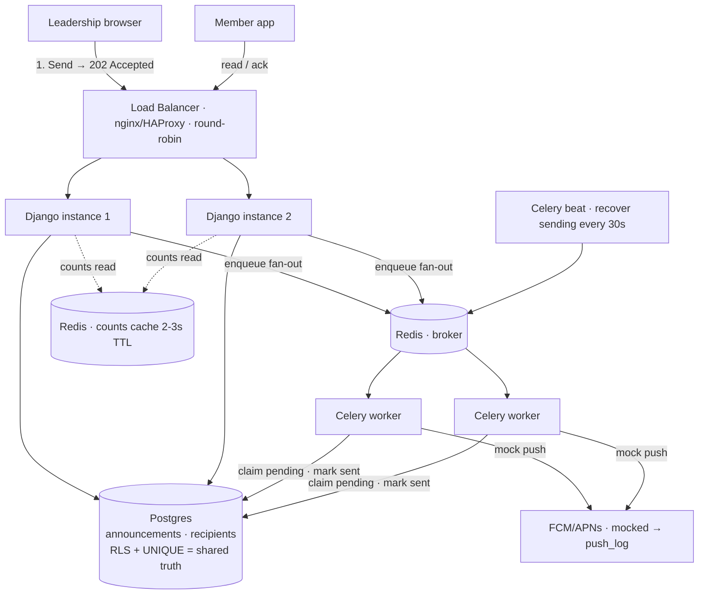

# CrewLink — Member Callout

A way for union leadership to send one announcement (a "callout") to their local and
actually see who got it, who read it, and who acknowledged it — built so one local's
data never reaches another, and so a retry or crash never delivers to the same member twice.

**Stack:** Django + DRF + Postgres (backend), Next.js (frontend), Docker Compose to run.

---

## Part 0 — Requirements

### What I'm building (explained back to Denise)

Leadership opens one screen, writes a title and body (or pastes a messy note and lets the
AI clean it up), picks who it goes to — the whole local, or just one job classification —
and hits send. Every member in that audience gets a push and can open the message,
acknowledge it, and (by design) say whether they're coming.

Leadership watches live counts on that same screen: how many it reached, how many read it,
how many acknowledged — so before you leave the hall you know who's actually coming.

Two things are non‑negotiable underneath it:

- **One local never sees another local's people or data.** A member can only read; they
  can't act as leadership.
- **If you hit send twice, or the system restarts mid‑send, nobody gets the message twice.**

A member who was underground all day isn't a lost cause: the message is stored, and they'll
see it the moment they open the app, even if the push never reached their phone.

### Assumptions (for everything the message doesn't spell out)

- **Who sends:** only a **leadership** account of a local can create and send callouts for
  that local. Members can only read / acknowledge / RSVP.
- **Who receives:** by default all **active** members of the local; optionally narrowed by
  **classification** (e.g. only "Apprentice 3rd Year"). Retired and suspended members are
  excluded by default.
- **What "immediately" / "missing people" means:** push is **best‑effort**. ~5–10% fail
  silently and members are offline for hours or days, so *delivered ≠ read*. We don't promise
  instant delivery; we promise the message is **never lost** and is retrievable the next time
  the member is online.
- **Confirming attendance (RSVP):** modeled in the schema and design as **optional** for a
  member — they may read/ack without ever RSVPing. (Per the brief, RSVP is design‑only, not
  in the build.)
- **Acknowledgement:** required only when the announcement's `needs_ack` is true.
  "Acknowledged" = the member explicitly confirmed receipt, which is stronger than "read".
- **What counts as done:** a send is done when **every active recipient has a terminal
  delivery row** (`sent` or `failed`) — not when every phone has buzzed, which we can't know.
  Leadership's "complete" means the fan‑out finished dispatching.
- **Identity:** each login maps to one account with a **role** (`member` | `leadership`) and
  exactly **one home local**. There are no cross‑local accounts.
- **Scale we design for:** the largest single callout is **22,400**; the platform holds
  **187,000** members across **43** locals. We design the fan‑out for 22,400; seed data stays
  small (brief).

### Things in the message that concern me

- **The contact‑info leak may already be real.** Denise asks whether outsiders can see the
  apprentices' contact info. If today's answer is "yes" or "we're not sure," that's a **Rule 1
  breach already in production** — and the brief says that costs people their jobs. This needs
  verifying first, and if real, a fix *plus* an audit of who accessed what. Access control is
  the first requirement here, not a feature.
- **"Retry a send that looks stuck" is a guarantee, not an edge case.** Leadership *will* press
  send again. Without idempotency built in from day one, that's a double‑send to 22,400 people.
- **Send is irreversible, and AI makes that sharper.** You can't recall 22,400 pushes once
  fan‑out starts. Combined with AI‑drafted text, there must be a **hard human‑approval gate** —
  an AI draft must never auto‑send.
- **"Who's coming by the day of" implies an event time the schema doesn't have.** RSVP only
  makes sense against a callout date / cutoff, and there's no such field yet. Flagging it as a
  modeling gap.

### Questions I'd ask Denise (and what I assumed instead, since I can't)

1. **"The apprentice contact‑info worry — has it actually happened, or is it a fear? And should
   any member info *ever* cross locals?"**
   *Assumed:* treat it as a real risk; **no** member data is ever visible across locals.
2. **"Do you ever need to reach only part of a local (just apprentices, one classification), or
   always everyone?"**
   *Assumed:* both — default is the whole local, with an **optional classification filter**
   (Part B confirms this).
3. **"Is RSVP something members *must* do, and is there a cutoff time you need answers by?"**
   *Assumed:* RSVP is optional; acknowledgement is required only when `needs_ack` is set; no
   hard cutoff is modeled yet (noted as a gap above).

---

## Part A — Design

> Four prompts below, **~900 of the 1,500‑word budget**, plus the diagram in §4.

### 1. Data model

Three tables stay as given (`locals`, `members`, `announcements`). I add two and extend one.

**`accounts`** — the piece deliberately missing from the brief, and the thing that makes Rule 1
possible. One row per login, linked to Django's auth user:

```
accounts
  id         uuid
  user_id    -> auth user          -- password, login
  local_id   uuid -> locals        -- the one home local; the scoping key
  role       text                  -- 'member' | 'leadership'
  member_id  uuid -> members        -- set when role='member', else null
```

Every request authorizes and scopes on `account.local_id` / `account.role` — never on a value
from the request body.

**`announcement_recipients`** — the fan‑out ledger the brief left out: one row per member per
announcement, and where "who it went to and what they did" lives:

```
announcement_recipients
  id               uuid
  announcement_id  uuid -> announcements
  member_id        uuid -> members
  local_id         uuid -> locals     -- denormalized from the announcement, so one RLS policy covers this table too
  delivery_state   text        -- pending | sending | sent | failed
  sent_at          timestamptz
  read_at          timestamptz -- null = not read
  acked_at         timestamptz -- null = not acknowledged
  rsvp             text        -- null | coming | cant
  UNIQUE(announcement_id, member_id)
  INDEX(announcement_id, delivery_state)
```

The five outcomes the brief asks for aren't one field — they're **orthogonal dimensions**:
*nothing* → row exists, `read_at` null; *read* → `read_at` set; *acknowledged* → `acked_at` set
(only meaningful when `needs_ack`); *coming / can't* → `rsvp`. A member can read without acking,
or ack without RSVPing. A single `status` enum would invent impossible orderings and lose
information, so I keep `delivery_state` (the machine's view: did we send?) separate from the
human's view (`read_at` / `acked_at` / `rsvp`).

**`announcements`** gains `state` (`draft | approved | sending | sent`), `classification_filter`
(nullable → whole local), `created_by`, and denormalized counters
`total/sent/read/acked_count` for cheap status reads (§2).

`UNIQUE(announcement_id, member_id)` does double duty: it models "one delivery per member" and
enforces Rule 2 at the database. Mock pushes are logged to a `push_log` table (announcement,
recipient, member, worker, result), which also feeds Rule 2 detection (§3).

### 2. The send path

**14:02:00 — leadership hits Send.** The request is deliberately tiny:

1. Authorize: is this account `leadership` of this announcement's local? (Rule 1)
2. Flip the announcement `approved → sending` **atomically** (the guard in §3).
3. After commit, enqueue one Celery fan‑out job. The `sending` row is also the durable
   recovery record if that publish fails.
4. Return **202 Accepted**.

Leadership waits ~100 ms — not for 22,400 pushes — and the UI switches to a status view.

**14:02:00.3 — the worker fans out.** It materializes recipients in one statement:

```sql
INSERT INTO announcement_recipients (announcement_id, member_id, local_id, delivery_state)
SELECT :aid, id, local_id, 'pending' FROM members
WHERE local_id = :local AND status = 'active'
  AND (:cls IS NULL OR classification = :cls)
ON CONFLICT (announcement_id, member_id) DO NOTHING;
```

22,400 rows in one insert, not a loop. It then claims `pending` rows in **chunks of ~500**, each
chunk in its own transaction so it's resumable; fanning those chunks across workers takes the
~37‑minutes‑if‑serial down to a few minutes. (The build dispatches chunks sequentially — already
sub‑second at seed scale; parallel fan‑out is the scaling step.) Each chunk logs its push and
advances the rows' state (§3).

**Status counts without hammering the DB.** Four people watching the screen must not each run
`COUNT(*) GROUP BY state` over 22,400 rows every second. Instead, workers increment the
**denormalized counters** on the announcement row as they go (`sent_count += chunk`), and
reads/acks bump their counters on the event. The status endpoint is a **single‑row read**,
wrapped in a **Redis cache with a 2–3 s TTL**. Four clients or forty, the DB sees at most one
read per TTL window; polling every few seconds is enough, no websockets required.

### 3. The two rules, by design

**Rule 1 — isolation — has two boundaries, and both must fail closed.**

*Local ↔ local.* The risk the brief names is a new endpoint next year that forgets to filter, so
enforcement can't live in each view's `.filter(local_id=...)` — one omission leaks. I push it
**below the application**: Postgres **Row‑Level Security**. Each request opens its connection with
`SET app.current_local = <account.local_id>`; RLS policies on `members`, `announcements` and
`announcement_recipients` restrict every row to that local. A forgotten filter now returns
nothing, not another local's data — the database refuses. A scoped base `Manager` backs this up
at the ORM layer so the default queryset is already local‑bounded.

*Member ↔ leadership.* Modeled as `account.role` + a **DRF permission on a base viewset** that all
write endpoints inherit; creating/sending requires `leadership`, so new endpoints are checked by
default rather than opting in. The apprentice‑contact‑info worry then becomes structural: another
local's members are never in any queryset, so they can't be serialized or leaked by a careless
field.

**Rule 2 — no double delivery — on retry or restart.** Three guards, all in shared DB state (never
process memory — that breaks across two instances):

- **Leadership presses Send twice:** `approved → sending` is a conditional
  `UPDATE ... WHERE state='approved' RETURNING`. The second press matches no row → no second
  fan‑out.
- **Fan‑out re‑runs:** `UNIQUE(announcement_id, member_id)` + `ON CONFLICT DO NOTHING` →
  re‑materializing creates zero duplicate rows.
- **Worker crashes mid‑send:** each chunk claims `pending` rows with `FOR UPDATE SKIP LOCKED`
  and commits the mock pushes, recipient states and counter together. A crash rolls the chunk
  back; committed chunks are skipped on recovery. Tasks use late acknowledgement, requeue on
  worker loss and retry transient database failures. Worker startup plus a Celery beat scan
  every 30 seconds requeue `sending` announcements, even if the original publish or Redis queue
  was lost. Discovery uses the owner connection for announcement/local IDs only; dispatch
  remains RLS-scoped. Recovery reuses the committed audience snapshot and ignores completed
  or unapproved announcements. Completion checks for remaining pending rows, including rows
  locked by other workers. Worker and scheduler containers restart after process failure.

**Catching a breach in production.**

- *Rule 1:* a reconciliation query that must always return 0 — recipients whose
  `member.local_id ≠ announcement.local_id`; plus audit logs and alerts on permission denials /
  RLS rejections.
- *Rule 2:* every real dispatch is logged with `recipient_id`; alert if `pushes_logged` ever
  exceeds `distinct recipients` for an announcement.

### 4. Diagram



The point the picture makes: the "already sent?" check lives in **Postgres**, shared by both
instances — not in either process's memory, where a second instance would silently defeat it.
*(Broker and counts cache can be the same Redis.)*

---

## The AI feature (design)

- Messy input → clean **title + body + a ≤120‑char push preview**.
- Produced as a **draft that must be approved** before it can send — the approval is the human
  gate in front of an irreversible fan‑out; **AI text never auto‑sends** (announcement starts in
  `draft`, moves to `approved` only by a human, and only `approved` can be sent).
- **Provider slow or down:** call it with a timeout; on failure fall back to manual editing.
  Never block the send path, and never let a hung provider push text to 22,400 people on its own.

---

## What I cut / would do next

- **RSVP (coming/can't)** is in the data model and the status design, but has no endpoint
  in the build — the brief marked it design‑only. Next: an RSVP endpoint plus the **event
  time / cutoff** field flagged in Part 0 (there's no "by the day of" without it).
- **Member‑facing UI** was left as endpoints only (brief said optional). The leadership
  screen is the built UI.
- **Real push (FCM/APNs) is mocked** to `push_log`. Next: a provider adapter behind the
  same per‑recipient state machine, plus a retry policy for provider-reported failures.
- **AI** is one provider (OpenAI) with an offline fallback; no streaming, no rate limiting,
  no cost controls.
- **`accounts` is not RLS‑scoped** — it's read via `request.user` to *derive* the local
  before the RLS var is set, so it can't be scoped by that same var. Only the user's own
  account is ever queried; a per‑tenant DB user or a user‑id policy would tighten it.
- **Counters are denormalized and incremented in app code**; a periodic reconcile job
  (the same query `check_rules` uses) would self‑heal any drift. Status is cached ~3s.
- **No pagination** on list/inbox — fine at seed scale, needed before 22k.
- **Fan‑out chunk size is fixed (500)** and untuned; no backpressure/rate limiting to the
  push provider yet.
- **Dev conveniences to change for prod:** `DEBUG`, open CORS, no password validators, a
  default secret in compose.
